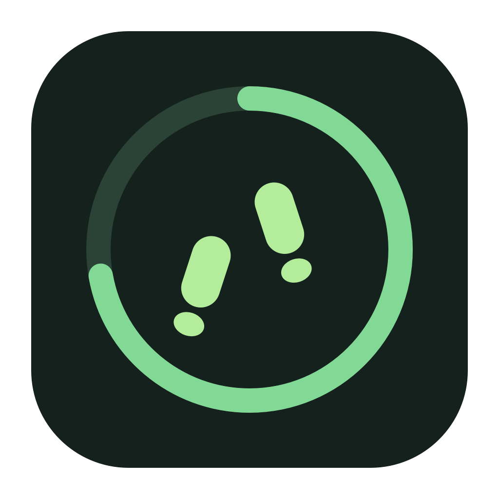

<p align="center"></p>

<h1 align="center">Walkingpad Companion</h1>
<p align="center">Keep moving while you work.<br>A native macOS menu bar companion for your WalkingPad.</p>
<p align="center"><a href="https://corentinmb.github.io/walkingpad-companion/">Website</a> · <a href="https://github.com/corentinmb/walkingpad-companion/releases">Downloads</a> · <a href="docs/releases.md">Build & release</a></p>

<p align="center"> </p>

## A little motivation, right in your menu bar

- **Your day at a glance.** Live steps, walking time and distance, with a personal daily step goal.
- **Treadmill controls.** Start, stop and adjust speed over Bluetooth; switch between manual and automatic mode.
- **A native interface.** SwiftUI, light and dark appearances, keyboard navigation and accessible controls.
- **Your walking history.** Saved workouts and statistics, including the active session.
- **Optional integrations.** MQTT for home automation and HCGateway for uploading steps.

## Get started

Requires **macOS 13 or later** and a compatible WalkingPad. Bluetooth support depends on the model; this project does not maintain a complete compatibility list.

Download a DMG or ZIP from [Releases](https://github.com/corentinmb/walkingpad-companion/releases), when available. Open the DMG, drag **Walkingpad Companion** to Applications, then launch it and allow Bluetooth access. Turn on your treadmill and open the menu bar icon.

The initial automated releases use ad-hoc signing. macOS may require approval in **System Settings → Privacy & Security → Open Anyway** after attempting to open the app. See [distribution and notarization](docs/releases.md) for Developer ID builds.

Click the goal below the ring to change your daily target. Choose Steps, Time or Distance to change the central metric. The ring always represents your daily step goal.

[Usage, statistics and integrations →](docs/usage.md)

## Build locally

Install Xcode with the macOS SDK, then:

```sh
./scripts/build-app.sh
open "dist/Walkingpad Companion.app"
```

This builds a universal app for Apple Silicon and Intel. For a faster local build, use `WALKINGPAD_ARCHS="$(uname -m)" ./scripts/build-app.sh debug`. Quit any existing instance first: the local statistics server uses port 4934.

For development, open `walkingpad-client.xcodeproj`, select the `walkingpad-client` scheme and press **⌘R**. The tracked project uses local ad-hoc signing without a personal development team. Swift packages resolve automatically.

```sh
sh tests/run-tests.sh
python3 -m unittest discover -s tests -p 'test_*.py'
./scripts/build-release.sh
```

Build output stays in ignored `.build/` and `dist/` directories. [Release instructions](docs/releases.md) cover archives, checksums, version tags and optional notarization.

## Built to be reused

The [design system](docs/design-system.md) lives in `walkingpad-client/designSystem/`: semantic colors, typography, spacing and reusable SwiftUI components. Presentation models keep formatting and control rules separate from Bluetooth services. [UI preview snapshots](tests/render-menu-preview.sh) run without a treadmill.

## Credits and license

Walkingpad Companion is an independently maintained fork of [WalkingPad macOS Client](https://github.com/klassm/walkingpad_macos_client), originally created by Matthias Klass.

The Bluetooth implementation was inspired by [ph4r05/ph4-walkingpad](https://github.com/ph4r05/ph4-walkingpad). Optional fitness synchronization uses [HCGateway](https://github.com/ShuchirJ/HCGateway).

Licensed under [Apache 2.0](LICENSE).
