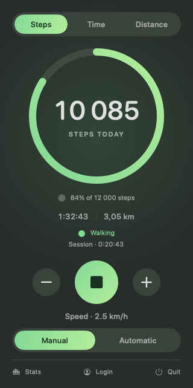
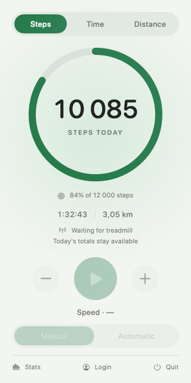

# Walkingpad design system

The menu bar uses a compact, rounded interface inspired by [rescenedev/Pomodoro](https://github.com/rescenedev/pomodoro) and the approved HTML exploration. The SwiftUI components are implemented independently for Walkingpad Companion. The visual language is a green accent, one prominent daily metric, restrained secondary text, and a clear primary treadmill command.

| Running · dark | Disconnected · light |
| --- | --- |
|  |  |

These previews render the actual SwiftUI panel with sample data, without starting Bluetooth or account services.

## Location and boundaries

`walkingpad-client/designSystem/` is the reusable UI layer:

| File | Responsibility |
| --- | --- |
| `WalkingpadTheme.swift` | Semantic colors, typography, spacing, sizing and motion |
| `WalkingpadComponents.swift` | Panel background, generic segmented selector, circular and quiet button styles |
| `WalkingpadProgressRing.swift` | Accessible clamped progress ring with arbitrary center content |

Components have no knowledge of Bluetooth, network clients, accounts or workout persistence. Use `MenuBarPanel` for the composed menu UI; `ContentView` supplies live service state and command closures. `MenuBarPresentation.swift` handles daily metric formatting, goal normalization and speed eligibility separately from styling.

## Tokens

Use `WalkingpadTheme.Colors` instead of literal feature colors. `text` and `secondaryText` follow native macOS text colors; panel/control/track/divider are semantic surfaces. `accentGradient` and `onAccent` are a matched pair for selected tabs and the main command. Selected-tab text maintains at least 4.5:1 contrast against both gradient endpoints in each appearance (covered by `ThemeContrastTests.swift`). Dynamic NSColor providers resolve automatically for Aqua and Dark Aqua; do not force a theme in product views.

Use `Spacing.tiny/small/medium/large/extraLarge` (4/8/12/20/24 pt). Typography exposes `metric`, `duration`, `caption`, `body`, and `detail`. Large numeric values use rounded monospaced digits to avoid movement as counters change; secondary text is at least 11 pt. Panel dimensions and progress-ring geometry live in `Layout`.

## Components

```swift
WalkingpadSegmentedControl(
    options: WorkoutMetric.allCases,
    selection: $metric,
    label: { $0.title }
)
.accessibilityLabel("Daily metric")

Button(action: start) {
    Image(systemName: "play.fill")
}
.buttonStyle(WalkingpadCircularButtonStyle(primary: true))
.accessibilityLabel("Start walking")

WalkingpadProgressRing(
    progress: 0.84,
    accessibilityDescription: "Daily step goal: 84 percent of 12,000 steps"
) {
    Text("10,085").font(WalkingpadTheme.Typography.metric)
}
```

The segmented selector takes any Hashable selection with ordered options and a label closure. It supports selected accessibility traits and arrow movement, uses native Button focus, and inherits disabled state. Only one primary circular button belongs in a command group; use secondary circular buttons for adjacent speed changes. Quiet buttons suit goal editing and footer actions.

The ring clamps fractions to 0...1, rejects non-finite values, and respects Reduce Motion. Its supplied accessibility description must describe both the central metric and the quantity represented by the ring. The menu ring always represents the daily **step** goal, even when its center shows time or distance. Zero progress leaves only the track; a completed goal fills the ring and preserves the full counter value.

## Product behavior

- Steps/time/distance come from the daily Workout, not fixed mockup data. Current-session time comes from the treadmill's last status.
- `dailyStepGoal` is stored locally with AppStorage, defaults to 12,000 and is editable through the goal button. The effective range is 1,000–50,000; UI changes use increments of 1,000.
- Start and Stop call the existing BLE commands. Stop sets speed to zero; it does not promise pause/resume semantics. Icons and speed reflect received status, without optimistic updates.
- Slower/faster change confirmed speed by 0.5 km/h within the previous 1.0–8.5 km/h selectable range. They are disabled without a connection/status, when stopped, at the relevant boundary, and in automatic mode.
- Manual/automatic switching remains available with a confirmed connected status.
- Without a treadmill, the daily summary and goal remain visible; all treadmill commands are disabled. Stats, account access and Quit retain their existing behavior.

## Verification

```sh
sh tests/run-tests.sh
xcodebuild -project walkingpad-client.xcodeproj -scheme walkingpad-client \
  -configuration Debug -destination 'platform=macOS,arch=arm64' \
  -derivedDataPath /tmp/walkingpad-build build
```

The tracked project supports macOS 13+, pinned Embassy and MQTTNIO packages, and ad-hoc local signing. Supply your own signing identity/team for distribution. New Swift files must also be included in the Xcode Sources build phase.

To render all four connection/activity states in both appearances, run `sh tests/render-menu-preview.sh /tmp/walkingpad-menu-previews`. This uses AppKit offscreen rendering, not screen capture permissions. The popover sizes itself from the hosting view’s fitting size, so its footer is not clipped by a fixed height.

Before release, check the actual popover in both system appearances, keyboard focus and VoiceOver, Reduce Motion, and a real treadmill: disconnected → connected/stopped → running → stopped; manual → automatic; both speed boundaries; goal editing across app restart; all three daily metric tabs; Login/Logout; Stats and Quit. Bluetooth behavior requires the physical device.
